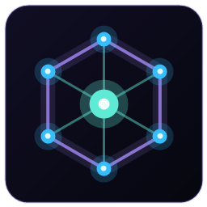

# Recon Deck

**Recon Deck** — настольная консоль для работы с открытыми источниками. Каталог из 150+ сервисов
разложен по 11 категориям, сайты открываются во встроенном Chromium, а весь трафик можно
переключить через **встроенный Tor** или **выходной прокси другой страны** в один клик.



## Запуск

**Готовый файл:** `dist\ReconDeck-1.0.0.exe` — portable-сборка, установка не нужна.

Из папки проекта:

```bat
start.bat
```

Или из терминала: `npm start`. Ярлык на рабочем столе создаёт `create-shortcut.bat`.

## VPN и Tor

Отдельный пункт **VPN** в боковом меню (а также плитки «Tor-браузер» и «Прокси по странам»).

### Tor

- В приложение встроен `tor.exe` (Tor 0.4.9.5) — ничего скачивать не нужно.
- Нажмите **«Подключить Tor»**: трафик всех вкладок пойдёт через сеть Tor, включая `.onion`.
- Показывается прогресс загрузки цепочки, выходной IP и кнопка «Новый маршрут».
- После подключения автоматически открывается встроенный **Tor-браузер** — собственный стартовый
  экран `recon://start` с IP, статусом и поиском. Это не внешний сайт, а экран внутри приложения.
- Кнопка **«Открыть Tor-браузер»** и плитка «Tor-браузер» открывают этот экран повторно.
- **Связка VPN → Tor:** если VPN уже подключён, Tor автоматически поднимается через него
  (`Socks5Proxy` / `HTTPSProxy`). Это обходит блокировку Tor. Проверено: VPN США →
  Tor, выходной IP `178.20.55.182`, `IsTor = true`.
- В панели видно «Tor через VPN: страна · host:port».
- Если Tor не поднялся, VPN-соединение сохраняется, а панель показывает ошибку.
- Если Tor блокируется без VPN, через 90 секунд появится понятная ошибка — подключитесь к VPN
  и повторите.

### VPN по странам

- Живой список бесплатных SOCKS5-узлов (источник: proxifly/free-proxy-list), 70 000+ адресов,
  ~90 стран. Список кэшируется на 6 часов.
- Первым идёт **«Лучший сервер»**: приложение замеряет пинг по странам и подключается
  к самому быстрому доступному узлу.
- Страны отсортированы **от лучшего пинга к худшему**; страны без ответа — в конце.
- У каждой страны — **флаг**, название и **лучший пинг** рядом с названием. Пинг замеряется
  в реальном времени при открытии вкладки и по кнопке «Обновить».
- Нажмите на страну — приложение **проверяет до 30 узлов**: для каждого замеряется пинг
  и доступность, затем оно подключается к самому быстрому.
- В списке узлов видно: пинг в мс, город, адрес `host:port`, кнопку «Подключить» у каждого узла
  и кнопку «Подключить лучший». «Проверить снова» заново замеряет пинг.
- При успехе появляется зелёный баннер **«Подключено · страна · IP · пинг · узел»**, IP также
  показывается в шапке панели и в кнопке **«IP: …»** рядом с «Отключить».
- Кнопка **«IP: …»** показывает текущий выходной IP и проверяет его заново по нажатию.
- Подключение проверяется реальным HTTPS-запросом, поэтому мёртвые и MITM-узлы отсеиваются.
- **Проверено:** после подключения к США в браузере открылся `ipinfo.io` и показал IP узла
  `109.199.115.190`, город и провайдера — обычные сайты через VPN работают.
- **Важно:** бесплатные прокси не шифруют трафик и видят домены, которые вы открываете.
  Не входите через них в личные аккаунты. Для чувствительных задач используйте Tor.

### Свой прокси

SOCKS5 или HTTP/HTTPS, с логином и паролем. Подходит для корпоративного или личного прокси.

## Возможности

- **11 категорий**: каталоги и фреймворки, поиск и дорки, домены и инфраструктура, люди и утечки,
  соцсети и мессенджеры, компании и финансы, изображения и геолокация, транспорт, **Dark Net**,
  анализ и визуализация, приватность и OPSEC.
- **Отдельная вкладка VPN**: Tor, живые узлы по странам с пингом и флагами, «Лучший сервер»,
  связка VPN → Tor и свой прокси.
- **Плитки с оригинальными иконками**, подпись сайта под иконкой.
- **Кнопка (i)** на каждой плитке — что делает сервис; кнопка **(i)** внизу меню — о приложении.
- **Встроенный Chromium**: вкладки, адресная строка, история, загрузки, масштаб, DevTools.
- **Свободное окно**: перетаскивание за точечный захват в шапке (и пустую область вкладок),
  изменение размера — за уголок в правом нижнем углу или за край окна.
- Поиск по названию, описанию, домену и категории, избранное и недавние (локально).
- Контекстное меню правой кнопкой, настройки с очисткой cookies/кэша.

## Горячие клавиши

| Комбинация | Действие |
|---|---|
| `Ctrl+K` | Поиск инструментов |
| `Ctrl+L` | Адресная строка |
| `Ctrl+T` | Библиотека / главная |
| `Ctrl+W` | Закрыть вкладку |
| `Ctrl+R` / `F5` | Обновить страницу |
| `Alt+←` / `Alt+→` | Назад / вперёд |
| `Ctrl+D` | Добавить страницу в избранное |
| `Ctrl+Shift+I` | DevTools страницы |
| `Esc` | Закрыть окно / отменить ввод |

## Сборка

```bat
npm install
npm run build
```

Результат: `dist\ReconDeck-1.0.0.exe` (portable x64). Для сборки нужен Node.js 22+.
Иконка приложения — `assets/icon.ico`, Tor-компонент — `resources/tor`.

## Структура

```
D:\w\recon deck
├─ start.bat                 запуск из исходников
├─ create-shortcut.bat       ярлык на рабочем столе
├─ main.js                   Electron: окно, вкладки, Tor, прокси, протокол recon://
├─ preload.js                мост renderer ↔ main
├─ src
│  ├─ index.html             интерфейс
│  ├─ styles.css             тёмная тема
│  ├─ app.js                 библиотека, поиск, избранное, панель «Сеть»
│  ├─ data.js                каталог инструментов
│  └─ tor-start.html         стартовый экран встроенного Tor-браузера
├─ resources/tor             tor.exe + tor.dll (встроенный Tor)
├─ assets                    иконки приложения
├─ scripts                   генератор иконок и ярлыка
└─ dist                      готовая portable-сборка
```

## Добавить свой инструмент

В `src/data.js` добавьте запись в нужную категорию:

```js
{ n: "Название", u: "https://example.com", d: "Коротко: за что отвечает" }
```

Перезапустите приложение — плитка, поиск и избранное подхватят запись.

## Приватность и правовые заметки

- Приложение не собирает телеметрию и не отправляет ваши данные.
- Cookies и сессии сайтов хранятся в отдельном профиле Electron (`persist:recon-deck`);
  очистка — в меню шестерёнки.
- Встроенный Tor — это `tor.exe` из проекта Tor (BSD-3-Clause), версия 0.4.9.5.
  Tor® — зарегистрированная торговая марка Tor Project.
- Бесплатные прокси — сторонние публичные узлы. Они не заменяют VPN: трафик до узла
  не шифруется, владелец узла видит домены. Не используйте их для личных аккаунтов.
- Работа с персональными данными, утечками и поиском по лицу регулируется законом.
  Используйте инструменты только в законных целях.
- Portable `.exe` не подписан сертификатом — SmartScreen может показать предупреждение.
  Это нормально для локальной сборки; исходники лежат рядом.

## Технологии

Electron 44 (Chromium 142), HTML/CSS/JavaScript, Tor 0.4.9.5, прокси-каталог proxifly.
Профиль и настройки — в `%APPDATA%\Recon Deck`.
